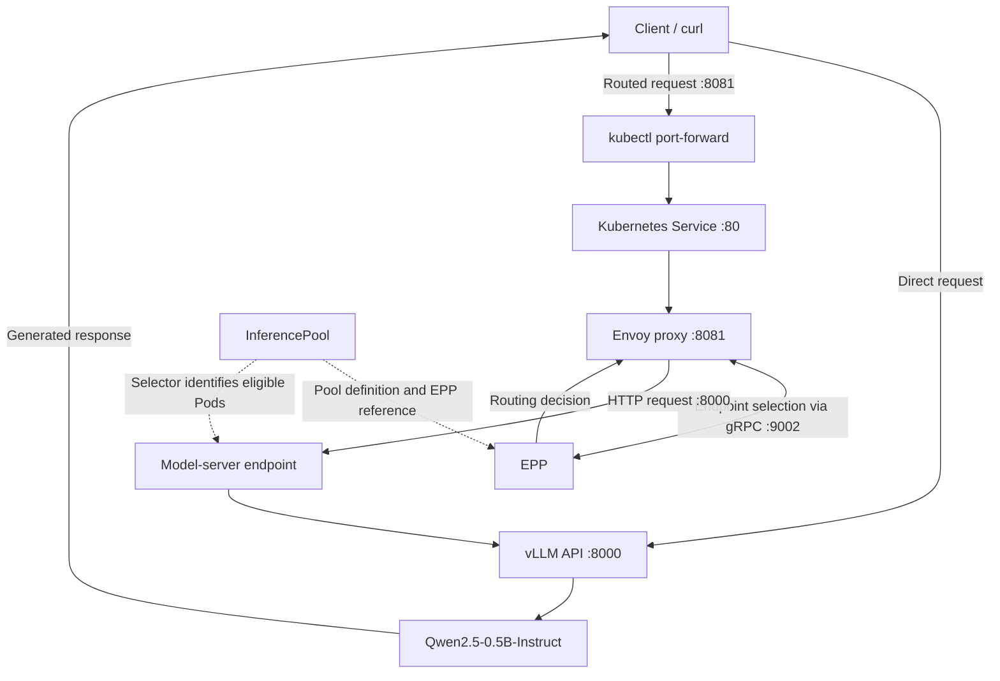

# llm-d CPU Demo: vLLM, Envoy and the Endpoint Picker

## 1. Overview

This demonstration shows how **llm-d adds inference-aware request routing to LLM serving on Kubernetes**.

**Related reference material:** [Main README and reading guide](../README.md) · [Conceptual guide: From Model to Production](from-model-to-production.md) · [vLLM Qwen3-8B live-demo runbook](vllm-qwen3-8b-runbook.md) · [Presentation deck](../slides/inference-stack.pdf)

We run a small Qwen model using vLLM on a CPU-only virtual machine, then send requests through the standalone llm-d routing stack.

The demo has two request paths:

1. **Direct inference:** The client sends a request directly to the vLLM model server.
2. **Inference-aware routing:** The client sends a request through Envoy, which consults the Endpoint Picker (EPP) before forwarding the request to a model-server endpoint.

The first path verifies that model inference works. The second demonstrates the integration between Envoy, EPP, the InferencePool and vLLM.

### Architecture



**Important:** Envoy and EPP run as two containers in the same Kubernetes Pod. The InferencePool defines the model-server pool and references the endpoint picker; it is not an additional network hop for every request.

## 2. Components

| Component | Role |
|---|---|
| Kubernetes | Runs and manages the workloads, Services and InferencePool resource. |
| vLLM | Loads the model and provides the OpenAI-compatible inference API. |
| Qwen2.5-0.5B-Instruct | The language model used for text generation. |
| Envoy | Receives HTTP requests and forwards them to model-server endpoints. |
| EPP (Endpoint Picker) | Selects an appropriate endpoint using configured routing logic and available inference-related signals. |
| InferencePool | Defines the eligible model-server endpoints and the EPP reference. |
| Kubernetes Services | Provide stable network endpoints for the model servers and routing components. |
| `kubectl port-forward` | Exposes the Kubernetes Services on local ports for the live demonstration. |

### What is EPP?

EPP stands for **Endpoint Picker**.

When Envoy receives a routed request, its external-processing filter communicates with EPP over gRPC. EPP applies the configured endpoint-selection logic and provides routing information to Envoy.

The standalone router uses the `optimized-baseline` configuration, including plugins associated with prefix-cache affinity and token/in-flight workload signals.

This allows the routing stack to account for characteristics relevant to LLM inference, rather than relying exclusively on generic network load-balancing criteria.

### What is Envoy?

Envoy is a high-performance proxy used to receive, process and forward network traffic.

In this demo, Envoy is the HTTP-facing component of the llm-d router. It consults EPP for an endpoint-selection decision and then forwards the request to the selected model-server endpoint.

**The distinction:**
- vLLM generates the model response.
- Envoy carries the request and response.
- EPP determines which eligible endpoint should handle the request.
- The InferencePool defines the pool of model-server endpoints.

## 3. Environment

- Kubernetes namespace: `llm-d-cpu-demo`
- Model: `Qwen/Qwen2.5-0.5B-Instruct`
- Inference engine: vLLM CPU image `docker.io/vllm/vllm-openai-cpu:v0.30.0`
- Model-server API port: `8000`
- EPP gRPC port: `9002`
- Envoy listener port inside the Pod: `8081`
- EPP Service HTTP port: `80`
- Local ports used for the demonstration: `8000` and `8081`
- Helm release: `llm-d-cpu-demo`
- Router chart: `llm-d-router-standalone-v0`

The model is configured with a maximum context length of 512 tokens and constrained CPU memory/concurrency settings to accommodate the VM's resources.

## 4. Step 1 — Inspect the running workloads

Run these commands on the VM.

### Check the Pods

```bash
kubectl get pods -n llm-d-cpu-demo -o wide
```

Expected workloads:

- `llm-d-cpu-demo-decode-...` — the vLLM model server.
- `llm-d-cpu-demo-epp-...` — the Pod containing Envoy and EPP.

The EPP Pod should show `2/2 Running`, indicating that both containers are running.

### Inspect Services

```bash
kubectl get svc -n llm-d-cpu-demo
```

Expected Services include:

| Service | Type | Port | Purpose |
|---|---|---|---|
| `llm-d-cpu-demo-epp` | ClusterIP | `80`, `9002`, `9090` | Exposes the router and its associated interfaces. |
| `llm-d-cpu-demo-epp-model-servers` | Headless Service | `8000` | Discovers/exposes model-server endpoints. |

The exact Service port mappings can be inspected using:

```bash
kubectl get svc llm-d-cpu-demo-epp \
  -n llm-d-cpu-demo -o yaml
```

### Inspect the InferencePool

```bash
kubectl get httproute,inferencepool \
  -n llm-d-cpu-demo
```

This demo has an InferencePool named `llm-d-cpu-demo`. No HTTPRoute is required for this standalone-router setup.

Inspect its configuration:

```bash
kubectl get inferencepool llm-d-cpu-demo \
  -n llm-d-cpu-demo -o yaml
```

Point out the model-server selector, target port and EPP reference.

## 5. Step 2 — Port-forward the model-server Service

Open a terminal on the VM and run:

```bash
kubectl port-forward -n llm-d-cpu-demo \
  svc/llm-d-cpu-demo-epp-model-servers 8000:8000
```

Keep this terminal running.

The mapping is:

```text
localhost:8000
    |
    v
Kubernetes Service:8000
    |
    v
vLLM model-server Pod:8000
```

This exposes the model server directly for testing. It bypasses the Envoy/EPP routing path.

### Verify the available model

In a second terminal:

```bash
curl -sS http://localhost:8000/v1/models
```

Expected result: a JSON response containing the model ID:

```text
Qwen/Qwen2.5-0.5B-Instruct
```

The response also reports the model's configured maximum context length.

### Send a direct chat-completions request

```bash
curl -sS http://localhost:8000/v1/chat/completions \
  -H 'Content-Type: application/json' \
  -d '{
    "model": "Qwen/Qwen2.5-0.5B-Instruct",
    "messages": [
      {
        "role": "user",
        "content": "Explain Kubernetes in one sentence."
      }
    ],
    "max_tokens": 60
  }'
```

Expected result: a JSON response containing a generated assistant message.

For example, the model may explain that Kubernetes is an open-source platform for deploying and managing containerized applications across multiple nodes.

### What this demonstrates

- The vLLM process is running.
- The model has loaded successfully.
- The OpenAI-compatible API is accessible.
- Text generation works on the CPU-only VM.

At this point, we have validated the model server, but have not demonstrated the llm-d routing path.

## 6. Step 3 — Port-forward the llm-d router Service

Stop the model-server port-forward with `Ctrl+C` if you no longer need it.

Start a port-forward to the EPP Service:

```bash
kubectl port-forward -n llm-d-cpu-demo \
  svc/llm-d-cpu-demo-epp 8081:80
```

Keep this terminal running.

The mapping is:

```text
localhost:8081
    |
    v
EPP Service:80
    |
    v
Envoy listener:8081
    |
    +---- EPP gRPC interface:9002
    |
    v
Selected model-server endpoint:8000
```

The local port `8081` is mapped to **Service port `80`**, not Service port `8081`.

The Service forwards traffic to the Envoy listener on port `8081` inside the Pod.

### Why not use local port 8080?

In this environment, local port `8080` was already occupied. Kubernetes therefore could not bind the requested local listener.

We resolved this by using local port `8081`:

```bash
kubectl port-forward -n llm-d-cpu-demo \
  svc/llm-d-cpu-demo-epp 8081:80
```

The port before the colon is the local port; the port after the colon is the Kubernetes Service port.

## 7. Step 4 — Send a request through Envoy and EPP

With the router port-forward running, open another terminal and execute:

```bash
curl -sS http://localhost:8081/v1/chat/completions \
  -H 'Content-Type: application/json' \
  -d '{
    "model": "Qwen/Qwen2.5-0.5B-Instruct",
    "messages": [
      {
        "role": "user",
        "content": "Explain Kubernetes in one sentence."
      }
    ],
    "max_tokens": 60
  }'
```

Expected result: a successful chat-completions response containing generated text.

### What happens when we execute this request?

1. `curl` sends an HTTP POST request to the local port `8081`.
2. `kubectl port-forward` carries the connection to port `80` of the EPP Kubernetes Service.
3. The Service forwards the request to Envoy's listener inside the EPP Pod.
4. Envoy's external-processing filter consults EPP through gRPC.
5. EPP applies its configured endpoint-selection logic and provides routing information.
6. Envoy forwards the request to the model-server endpoint.
7. vLLM executes the Qwen model and generates the response.
8. Envoy returns the response to the client.

This is the primary demonstration of the integrated llm-d routing path.

## 8. Step 5 — Compare the two request paths

| Direct request | Routed request |
|---|---|
| `http://localhost:8000/v1/chat/completions` | `http://localhost:8081/v1/chat/completions` |
| Reaches the model server directly | Enters through Envoy and consults EPP |
| Validates vLLM and model inference | Validates the integrated routing path |
| Bypasses Envoy/EPP | Uses Envoy/EPP before reaching vLLM |

Both requests ultimately use the same model server in this demo.

A successful routed request shows that the Envoy/EPP integration can route traffic to the model server. Because only one model-server replica is deployed, it does not demonstrate meaningful load balancing among competing replicas.

## 9. Optional — Inspect the router logs

To inspect Envoy logs:

```bash
kubectl logs -n llm-d-cpu-demo \
  deploy/llm-d-cpu-demo-epp \
  -c envoy-proxy --tail=50
```

To inspect EPP logs:

```bash
kubectl logs -n llm-d-cpu-demo \
  deploy/llm-d-cpu-demo-epp \
  -c epp --tail=50
```

These can help investigate routing errors or verify component activity. Log formats and the amount of request-level detail depend on the component configuration.

## 10. Key takeaway

Traditional model serving exposes an inference API. llm-d adds a routing layer designed to account for the characteristics of LLM workloads.

In this demonstration:

- **vLLM** runs the model.
- **Envoy** receives and forwards requests.
- **EPP** makes endpoint-selection decisions.
- **InferencePool** defines the eligible model-server pool.
- **Kubernetes** runs and connects the components.

The direct request establishes that inference works. The routed request demonstrates the integration between the model-serving and inference-aware routing components.

### Scope and limitations

This is a CPU-only, single-model-server demonstration. It is intended to explain the architecture and verify the request path, not to benchmark performance.

It does not demonstrate multi-replica load balancing, GPU acceleration, distributed inference, or disaggregated prefill/decode.
